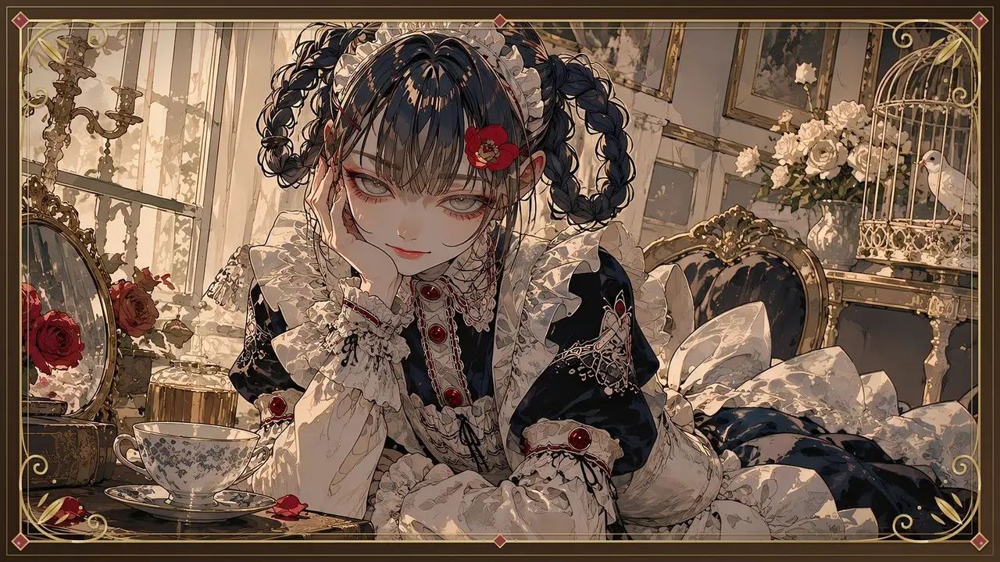

<!-- 文字均由 scripts/render.py 以霞鹜文楷（LXGW WenKai）渲染为 SVG；
     卡片按访客自己的 GitHub 主题显示：亮色主题看白色版，暗色主题看黑色版 -->

<!-- 动态主页图（scripts/animate.py 生成，8 秒无缝循环）：呼吸、眨眼与视线、表情、头部微倾、发丝独立飘动、蝴蝶结/蕾丝/袖口/宝石链各按材质摆动。
     主图为 AVIF（1920×1080 · 60fps · AV1 4:4:4，色度不降采样，红唇与线稿边缘无锯齿）；不支持动态 AVIF 的浏览器回退到 WebP（1280×720 · 30fps）；点击打开 1080p60 MP4 -->
<a href="./assets/gothic-lolita.mp4"><picture>
  <source srcset="./assets/gothic-lolita.avif" type="image/avif" />
  
</picture></a>

<!-- 信息卡片随台北时间切换：06:00–17:59 使用浅色主题，18:00–05:59 使用深色主题；顶部动态插画保留原始配色。 -->

