<!-- 文字均由 scripts/render.py 以霞鹜文楷（LXGW WenKai）渲染为 SVG；
     卡片按访客自己的 GitHub 主题显示：亮色主题看白色版，暗色主题看黑色版 -->

<!-- 动态主页图（scripts/animate.py 生成，8 秒无缝循环）：呼吸、眨眼与视线、头部微倾、发丝独立飘动、蝴蝶结/蕾丝/袖口/宝石链各按材质摆动；点击打开 2560×1440 · 60fps MP4 原片 -->

<picture>
  <source media="(prefers-color-scheme: dark)" srcset="./assets/svg/card-dark.svg" />
  <source media="(prefers-color-scheme: light)" srcset="./assets/svg/card-light.svg" />
  
</picture>

